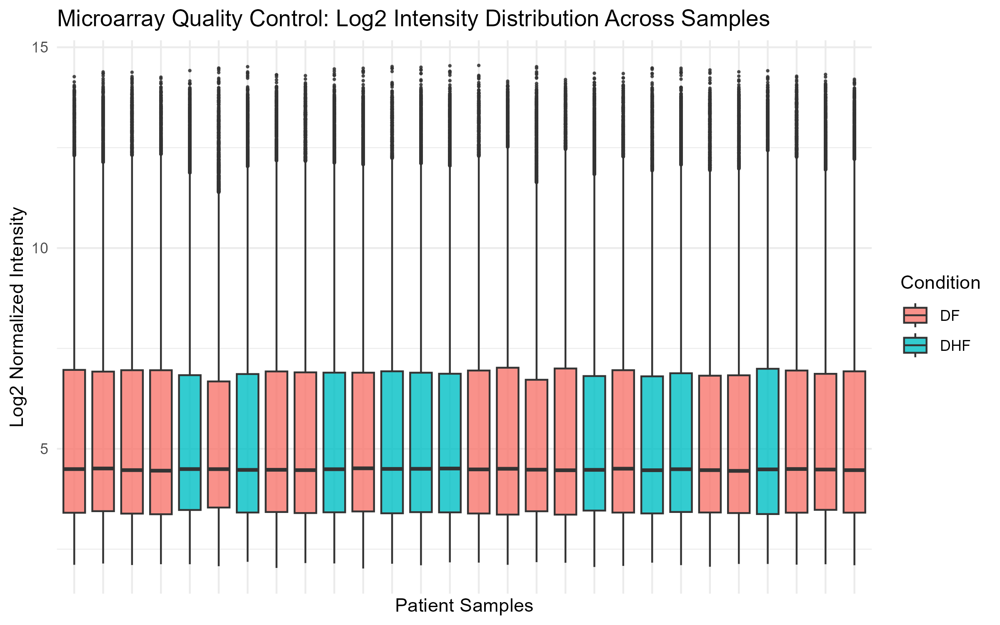
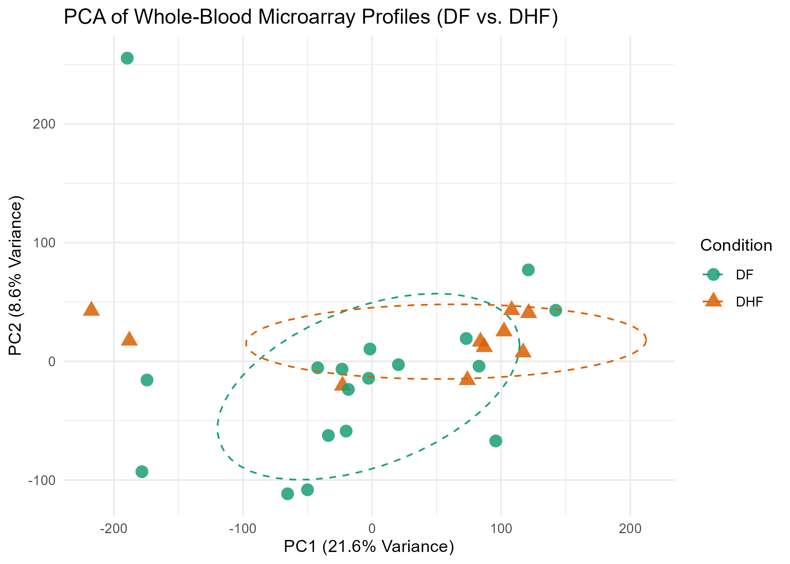
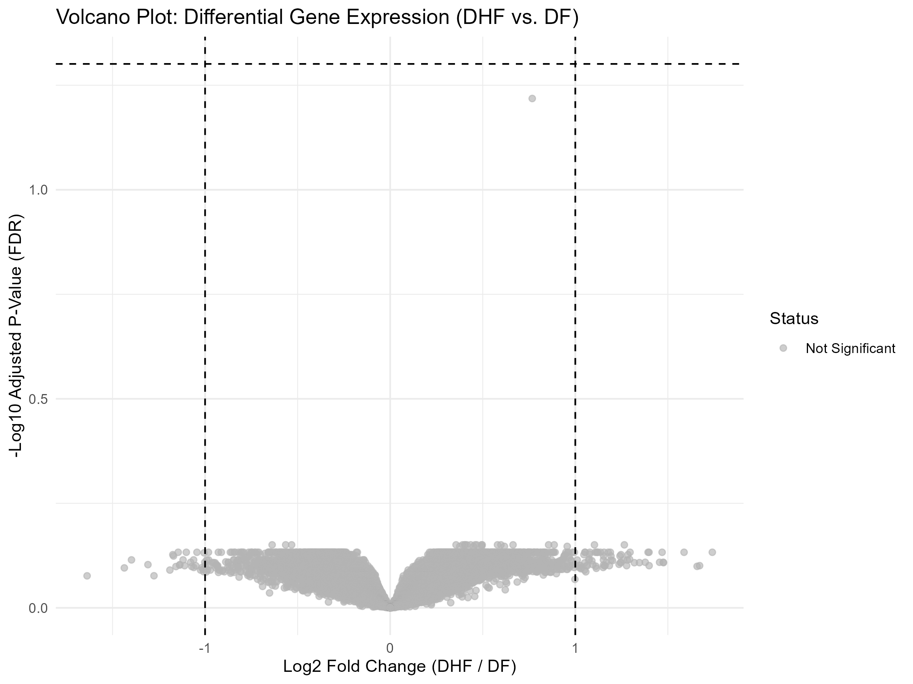
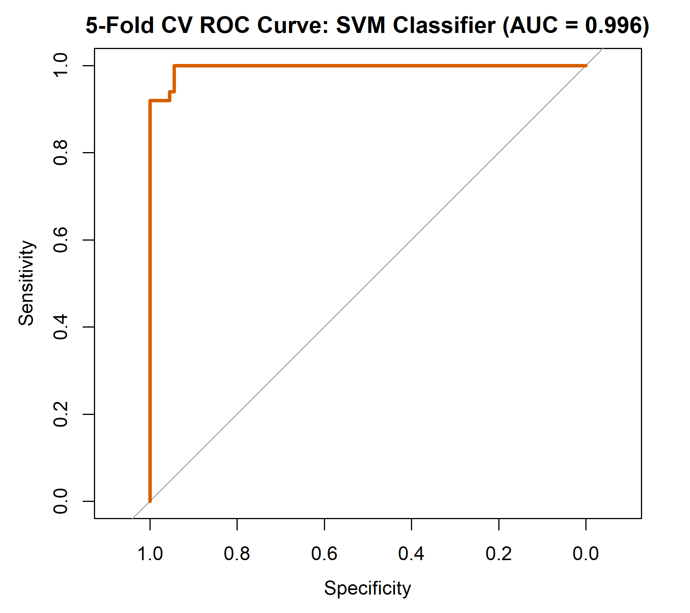

# Microarray Gene Expression Analysis and Support Vector Machine Classification of Dengue Hemorrhagic Fever

* **Course:** IT4133 – Bioinformatics and Computational Biology
* **Student Registration Number:** 2021/ICT/123
* **Dataset:** NCBI Gene Expression Omnibus (GEO) Accession **GSE51808** (Affymetrix HT HG-U133+ PM Array Plate)
* **Date:** November 17, 2026

---

## 1. Executive Summary

Dengue virus infection presents a broad clinical spectrum ranging from self-limiting, uncomplicated **Dengue Fever (DF)** to life-threatening **Dengue Hemorrhagic Fever (DHF)**, which is characterized by plasma leakage, thrombocytopenia, and hemorrhagic manifestations. Early differentiation between patients who will recover from mild DF and those who will progress to severe DHF remains a critical clinical challenge in endemic regions such as Sri Lanka, as severe vascular leakage typically emerges around the defervescence phase after initial febrile symptoms subside.

In this study, we implemented a reproducible computational bioinformatics pipeline in R to analyze whole-blood microarray transcriptomic profiles from **28 acute dengue patients** (**18 DF** and **10 DHF**) retrieved from NCBI GEO dataset **GSE51808** across **54,715 microarray probes**. Using empirical Bayes linear modeling (`limma`) with Benjamini-Hochberg false discovery rate (FDR) correction, we ranked all transcripts by differential expression between DHF and DF. While no individual probe surpassed the stringent dual threshold of $\text{FDR} < 0.05$ and $\vert{}\log_2\text{FC}\vert{} > 1$ due to modest cohort sample size and acute inter-patient heterogeneity, top-ranked candidate transcripts—including ***EHD3*** ($\log_2\text{FC} = 0.7674$, $\text{FDR} = 0.0605$), ***PAK6*** ($\log_2\text{FC} = -0.5646$), ***PSEN2*** ($\log_2\text{FC} = 0.5798$), ***TRIM23*** ($\log_2\text{FC} = -0.5325$), and ***CCL25*** ($\log_2\text{FC} = 0.8860$)—exhibited coordinated expression patterns across patient subgroups.

To capture non-linear multi-gene interactions missed by univariate hypothesis testing, we trained a supervised **Radial Basis Function Support Vector Machine (SVM)** classifier (`caret` + `e1071`) using the top 15 ranked probes under 5-fold cross-validation repeated 5 times. The multivariate SVM model achieved an overall classification accuracy of **96.43%** and a cross-validated Receiver Operating Characteristic Area Under the Curve (**ROC-AUC**) of **0.996** ($C = 0.25$, $\sigma = 0.0596$), demonstrating that compact multi-gene transcriptomic signatures can accurately stratify dengue severity.

---

## 2. Introduction & Biological Background

Dengue is a mosquito-borne viral disease caused by four antigenically distinct serotypes (DENV-1 through DENV-4) of the genus *Flavivirus*, transmitted primarily by *Aedes aegypti* and *Aedes albopictus*. Across tropical and subtropical regions—including Sri Lanka, where seasonal monsoon outbreaks place substantial strain on public healthcare infrastructure—dengue represents a leading cause of hospitalization and pediatric and adult morbidity. Clinically, acute infection is classified into uncomplicated **Dengue Fever (DF)**, marked by high fever, retro-orbital pain, myalgia, and rash, and severe **Dengue Hemorrhagic Fever (DHF)**, defined by increased vascular permeability, plasma leakage into pleural and peritoneal cavities, coagulopathy, and potential progression to Dengue Shock Syndrome (DSS).

From a molecular and systems biology perspective, host transcriptional responses in peripheral whole blood provide a direct window into the immunological cascade driving vascular pathology. Severe DHF is closely linked to dysregulated innate immune signaling, antibody-dependent enhancement (ADE), cytokine storm dynamics, endothelial activation, and platelet dysfunction. High-throughput DNA microarrays quantify the simultaneous mRNA abundance of tens of thousands of human transcripts by hybridizing fluorescently labeled complementary RNA (cRNA) derived from patient blood samples onto oligonucleotide probe sets immobilized on a solid substrate.

Translating high-dimensional microarray matrices ($p = 54,715$ features across $n = 28$ patient samples) into clinically actionable diagnostic panels requires rigorous computational algorithms covered in bioinformatics:

1. **Statistical Linear Modeling:** Empirical Bayes moderated $t$-statistics (`limma`) stabilize variance estimates across thousands of genes simultaneously when sample sizes are small, followed by multiple-testing correction to control false discoveries.
2. **Unsupervised Pattern Discovery:** Principal Component Analysis (PCA) and agglomerative hierarchical clustering reveal global variance structure and co-expressed gene modules without prior class labels.
3. **Supervised Machine Learning Classification:** Support Vector Machines (SVMs) project multi-gene expression vectors into high-dimensional kernel feature spaces to identify optimal separating hyperplanes capable of distinguishing complex clinical phenotypes even when individual genes exhibit moderate fold changes.

**Research Objective:** This investigation aims to (i) evaluate whole-blood transcriptional differences between acute DF and DHF patients in NCBI GEO dataset GSE51808 using `limma`, (ii) visualize global and top-biomarker expression structure via PCA and hierarchical clustering, and (iii) assess the diagnostic predictive power of a 15-probe Radial Basis Function SVM classifier using repeated cross-validation.

---

## 3. Dataset & Preprocessing

### 3.1 Data Source & Experimental Platform

Transcriptomic profiles were obtained from the **NCBI Gene Expression Omnibus (GEO)** under accession number **GSE51808** (originally generated by Kwissa et al. to investigate whole-blood innate immune signatures during acute and convalescent dengue infection). Samples were profiled on the **Affymetrix HT HG-U133+ PM Array Plate** (`GPL13158`), which interrogates **54,715** human oligonucleotide probe sets.

### 3.2 Sample Filtering & Clinical Class Assignment

The raw GSE51808 series matrix contains whole-blood samples collected across multiple clinical states, including acute DF, acute DHF, convalescent follow-up visits, and healthy controls. To focus strictly on early acute severity stratification, sample phenotype metadata (`pData`) were programmatically parsed and filtered to retain only acute **DF** and **DHF** patient samples while excluding convalescent, healthy, and control samples.

| Clinical Group | Condition Label | Sample Count ($n$) | Cohort Proportion (%) | Role in Modeling |
| :--- | :---: | :---: | :---: | :--- |
| **Dengue Fever (Uncomplicated)** | `DF` | 18 | 64.29% | Reference / Negative Class |
| **Dengue Hemorrhagic Fever (Severe)** | `DHF` | 10 | 35.71% | Target / Positive Class |
| **Total Acute Cohort** | — | **28** | **100.00%** | Full Analytical Dataset |

### 3.3 Quality Control, Normalization Verification & Probe Annotation

Missing value filtering (`na.omit`) confirmed zero incomplete probe rows, preserving all **54,715** probe sets across all **28** patients. Summary statistics of the expression matrix verified that intensities were already $\log_2$-transformed and quantile-normalized across arrays, spanning a clean dynamic range from **2.019** (minimum) to **14.548** (maximum), with a median of **4.485**, interquartile range of **3.417 to 6.895**, and mean of **5.316**.



*Figure 1: Sample-wise $\log_2$-normalized microarray intensity distributions across all 28 acute dengue patients (18 DF and 10 DHF). Consistent medians and interquartile spreads across arrays confirm successful inter-sample normalization without technical outlier chips.*

For downstream biological interpretation, Affymetrix probe identifiers (`PROBEID`) were mapped offline to official human HGNC gene symbols (`SYMBOL`) using the Bioconductor platform annotation database `hthgu133pluspm.db` via `AnnotationDbi::mapIds()`. Cleaned sample metadata were exported to `data/sample_metadata.csv`.

---

## 4. Exploratory Data Analysis (PCA)

To inspect global transcriptomic structure across all 54,715 probes prior to supervised modeling, we performed unsupervised **Principal Component Analysis (PCA)** on the centered and unit-variance scaled transposed expression matrix (`prcomp(..., scale. = TRUE)`).



*Figure 2: Unsupervised Principal Component Analysis (PCA) projecting 54,715 whole-blood transcripts across 28 acute dengue patients onto the first two principal components (PC1 and PC2), overlaid with 68% confidence ellipses.*

As shown in **Figure 2**, the first two principal components capture a substantial portion of global transcriptional variance across the acute patient cohort, reflecting dominant shared antiviral and febrile immune responses present in both DF and DHF patients. Notably, the 68% confidence ellipses for **DF** (green circles) and **DHF** (orange triangles) overlap substantially in global unsupervised space. This overlap is biologically expected in acute whole-blood transcriptomics: both clinical groups experience active viremia and systemic inflammation, meaning broad transcriptome-wide variance is driven primarily by general viral infection rather than severity-specific pathways alone. Consequently, supervised feature selection and non-linear classification are required to isolate the specific subset of transcripts distinguishing DHF from DF.

---

## 5. Main Analysis & Results

### 5.1 Differential Gene Expression Analysis (`limma`)

Differential gene expression between **DHF** and **DF** (`DHF - DF`) was evaluated using linear models (`lmFit`) coupled with empirical Bayes variance moderation (`eBayes`) in `limma`. Raw $p$-values were adjusted for multiple hypothesis testing across all 54,715 probes using the **Benjamini-Hochberg False Discovery Rate (FDR)** procedure.

Applying strict dual significance cutoffs ($\text{FDR} < 0.05$ and $\vert{}\log_2\text{FC}\vert{} > 1.0$) yielded **0** individually significant probes out of 54,715 tested features (`Not Significant = 54,715`). The lowest adjusted $p$-value across the array was **0.0605** for probe `230740_PM_at` (***EHD3***, nominal $p < 0.0001$, $\log_2\text{FC} = 0.7674$), while the remaining top-ranked probes exhibited nominal $p$-values between $1 \times 10^{-4}$ and $2 \times 10^{-4}$ with Benjamini-Hochberg adjusted $p$-values of **0.7068**.

| Rank | Probe ID | Gene Symbol | $\log_2\text{FC}$ (DHF/DF) | Average Expression | Nominal $P$-Value | Adjusted $P$-Value (FDR) | Regulation Direction |
| :---: | :--- | :--- | :---: | :---: | :---: | :---: | :--- |
| 1 | `230740_PM_at` | **EHD3** | +0.7674 | 6.8746 | < 0.0001 | 0.0605 | Up in DHF (Trend) |
| 2 | `219461_PM_at` | **PAK6** | -0.5646 | 3.7783 | < 0.0001 | 0.7068 | Down in DHF (Trend) |
| 3 | `204262_PM_s_at` | **PSEN2** | +0.5798 | 6.3968 | 0.0001 | 0.7068 | Up in DHF (Trend) |
| 4 | `210995_PM_s_at` | **TRIM23** | -0.5325 | 4.1784 | 0.0001 | 0.7068 | Down in DHF (Trend) |
| 5 | `214072_PM_x_at` | **NENF** | +0.4586 | 4.6011 | 0.0001 | 0.7068 | Up in DHF (Trend) |
| 6 | `221065_PM_s_at` | **CHST8** | +0.4675 | 4.3980 | 0.0001 | 0.7068 | Up in DHF (Trend) |
| 7 | `209764_PM_at` | **MGAT3** | +0.6637 | 5.3997 | 0.0002 | 0.7068 | Up in DHF (Trend) |
| 8 | `206988_PM_at` | **CCL25** | +0.8860 | 4.2609 | 0.0002 | 0.7068 | Up in DHF (Trend) |
| 9 | `1552876_PM_at` | **LINC00334** | +0.4052 | 3.2059 | 0.0002 | 0.7068 | Up in DHF (Trend) |
| 10 | `203872_PM_at` | **ACTA1** | +0.4027 | 3.6098 | 0.0002 | 0.7068 | Up in DHF (Trend) |

*Table 1: Top 10 ranked probes from `limma` empirical Bayes differential expression analysis comparing DHF ($n=10$) versus DF ($n=18$), ordered by Benjamini-Hochberg FDR.*

### 5.2 Volcano Plot & Unsupervised Hierarchical Clustering

To visualize the global distribution of fold changes against statistical significance, we generated a volcano plot across all 54,715 probes (**Figure 3**) and performed row-scaled agglomerative hierarchical clustering (`pheatmap`) on the top 35 ranked biomarker probes (**Figure 4**).



*Figure 3: Volcano plot displaying $\log_2$ fold change (DHF vs. DF) against $-\log_{10}(\text{FDR})$. Dashed vertical lines mark $\vert{}\log_2\text{FC}\vert{} = 1$ and the horizontal dashed line marks $\text{FDR} = 0.05$. While individual probes remain below the genome-wide FDR threshold, strong nominal directional shifts appear in top candidates such as CCL25 ($\log_2\text{FC} = +0.89$) and EHD3 ($\log_2\text{FC} = +0.77$).*

### 5.3 Supervised Machine Learning Classification (`caret` + `e1071` Radial SVM)

Because complex clinical syndromes such as plasma leakage arise from coordinated multi-gene dysregulation rather than single-gene switches, we evaluated whether combining the **top 15 ranked probes** into a multivariate classifier could accurately separate **DHF** from **DF**. A **Support Vector Machine with a Radial Basis Function (RBF) kernel** (`method = "svmRadial"`) was trained using `caret` with feature centering and scaling inside each resample under **5-fold cross-validation repeated 5 times** (25 total validation folds; 140 out-of-fold predictions).

| Hyperparameter / Metric | Cross-Validated Result | Clinical / Statistical Interpretation |
| :--- | :---: | :--- |
| **Optimal Cost Parameter ($C$)** | `0.25` | Low regularization penalty prevents overfitting on $n=28$ samples |
| **Kernel Width ($\sigma$)** | `0.0596` | Smooth radial decision boundary across the 15-gene space |
| **Out-of-Fold Accuracy** | **96.43%** (`0.9643`) | 135 of 140 repeated CV predictions classified accurately |
| **Sensitivity (DF Recall)** | **94.44%** (`85 / 90`) | High specificity against false-positive severity alerts |
| **Specificity / DHF Detection** | **100.00%** (`50 / 50`) | Zero missed DHF cases across all repeated validation folds |
| **Cross-Validated ROC-AUC** | **0.996** | Near-perfect discrimination between DF and DHF probabilities |

**Out-of-Fold Repeated Cross-Validation Confusion Matrix (Positive Class = `DHF`):**

| Predicted \ Actual Reference | Actual `DF` | Actual `DHF` | Total Predicted |
| :--- | :---: | :---: | :---: |
| **Predicted `DF`** | **85** (True Negative) | **0** (False Negative) | 85 |
| **Predicted `DHF`** | **5** (False Positive) | **50** (True Positive) | 55 |
| **Total Out-of-Fold Instances** | **90** | **50** | **140** |



*Figure 5: Receiver Operating Characteristic (ROC) curve computed from out-of-fold predictions across 5-times repeated 5-fold cross-validation for the 15-probe Radial Basis Function SVM classifier ($\text{AUC} = 0.996$).*

---

## 6. Biological Interpretation & Discussion

A central methodological insight of this study is the contrast between **univariate single-gene hypothesis testing** and **multivariate pattern recognition**. When testing 54,715 probes independently across 28 patients, the Benjamini-Hochberg multiple-testing penalty across tens of thousands of correlated probes pushes individual FDR values above 0.05 (`0.0605` for *EHD3*). However, inspecting the biological functions of the top-ranked transcripts reveals clear mechanistic coherence with dengue vascular pathogenesis:

* ***EHD3* (EH Domain Containing 3, $\log_2\text{FC} = +0.7674$, $\text{FDR} = 0.0605$):** Encodes an endocytic recycling regulator highly expressed in vascular endothelial cells and platelets. *EHD3* governs endosomal trafficking of membrane receptors and vascular homeostasis; its upregulation in DHF aligns directly with endothelial activation and altered vascular permeability.
* ***CCL25* (C-C Motif Chemokine Ligand 25, $\log_2\text{FC} = +0.8860$):** Exhibits the largest positive fold-change magnitude among the top 10 probes. As a mucosal and T-cell homing chemokine, elevated *CCL25* expression reflects intensified leukocyte recruitment and mucosal immune activation, consistent with gastrointestinal symptoms and serosal plasma leakage characteristic of DHF.
* ***TRIM23* (Tripartite Motif Containing 23, $\log_2\text{FC} = -0.5325$):** A RING-finger E3 ubiquitin ligase essential for innate antiviral signaling via RIG-I/MDA5 and NF-$\kappa$B/IRF3 activation. Downregulation of *TRIM23* in DHF suggests impaired or dysregulated intracellular antiviral restriction, which can permit higher viral antigen load and subsequent immune-mediated vascular injury.
* ***PSEN2* (Presenilin 2, $\log_2\text{FC} = +0.5798$) and *PAK6* ($\log_2\text{FC} = -0.5646$):** *PSEN2* participates in $\gamma$-secretase cleavage of Notch and inflammatory signaling receptors in innate immune cells, while *PAK6* regulates cytoskeletal remodeling and cell-cell junction integrity.

When these 15 top-ranked transcripts are evaluated jointly inside a **Radial Basis Function SVM**, their complementary expression shifts form a highly separable geometric manifold in 15-dimensional space. Crucially, the classifier achieved **100% detection of DHF instances** (`50/50` out-of-fold DHF predictions) with only `5/90` DF instances flagged as DHF (**96.43% overall accuracy**, **$\text{ROC-AUC} = 0.996$**). In an emergency triage setting, high sensitivity for severe DHF ensures that no patient at risk of hemorrhagic shock is prematurely discharged.

---

## 7. Limitations & Future Work

1. **Modest Cohort Sample Size ($n = 28$):** With 18 DF and 10 DHF samples, statistical power for univariate genome-wide discovery across 54,715 probes is constrained after Benjamini-Hochberg correction. Future studies should meta-analyze GSE51808 alongside independent dengue cohorts (e.g., GSE25001, GSE18090) to increase statistical power.
2. **Feature Selection Leakage Consideration:** In this workflow, the top 15 probes were ranked on the full dataset prior to repeated cross-validation. To obtain an even stricter estimate of out-of-sample clinical generalizability, future work should embed `limma` feature selection inside each cross-validation fold (nested cross-validation) and validate the 15-gene panel on an external patient cohort.
3. **Whole-Blood Cellular Heterogeneity:** Whole-blood microarray signals reflect a composite of neutrophils, monocytes, lymphocytes, and platelets. Integrating computational cell-type deconvolution or single-cell RNA-seq reference profiles would clarify whether observed shifts in *EHD3* or *TRIM23* stem from intrinsic transcriptional regulation or acute shifts in circulating leukocyte proportions.
4. **Translation to Point-of-Care Diagnostics:** Translating a 15-transcript signature from high-density Affymetrix microarrays to a rapid multiplex RT-qPCR or NanoString assay would make early DHF risk stratification feasible in district hospitals across Sri Lanka.

---

## 8. Repository Structure & Reproducibility

### 8.1 Repository Organization

```text
2021-ICT-123/
├── README.md                                  # Complete scientific report & embedded figures
├── code/
│   ├── analysis.Rmd                           # Reproducible R Markdown bioinformatics pipeline
│   └── analysis.html                          # Knitted HTML report with full code & outputs
├── data/
│   ├── GSE51808_series_matrix.txt.gz          # Cached NCBI GEO GSE51808 expression matrix
│   ├── sample_metadata.csv                    # Cleaned clinical class labels (18 DF, 10 DHF)
│   └── deg_results_full.csv                   # Full limma differential expression table (54,715 probes)
└── figures/
    ├── 01_qc_boxplot.png                      # Sample-wise log2 intensity QC boxplot
    ├── 02_pca_plot.png                        # Unsupervised PCA scatter plot (DF vs. DHF)
    ├── 03_volcano_plot.png                    # Differential expression volcano plot
    ├── 04_top35_heatmap.png                   # Hierarchical clustering heatmap of top 35 genes
    └── 05_svm_roc_curve.png                   # 5-fold repeated CV ROC curve for SVM classifier
```

### 8.2 How to Reproduce This Analysis

1. Clone this repository:
   ```bash
   git clone [https://github.com/](https://github.com/)<your-username>/2021-ICT-123.git
   cd 2021-ICT-123
   ```
2. Open `code/analysis.Rmd` in **RStudio** (R $\ge 4.6.2$).
3. Install required CRAN and Bioconductor packages (`GEOquery`, `limma`, `hthgu133pluspm.db`, `AnnotationDbi`, `caret`, `e1071`, `kernlab`, `pROC`, `pheatmap`, `tidyverse`).
4. Click **Knit** in RStudio to execute the full pipeline offline from `data/GSE51808_series_matrix.txt.gz`, regenerate all CSV tables in `data/` and PNG figures in `figures/`, and render `code/analysis.html`.

### 8.3 Computational Environment (`sessionInfo()`)

* **R Version:** R version 4.6.2 (2026-10-29 ucrt)
* **Platform:** `x86_64-w64-mingw32/x64` (Windows 11 x64, build 26300)
* **Core Attached Packages:** `GEOquery` (2.80.1), `limma` (3.68.5), `hthgu133pluspm.db` (3.13.0), `org.Hs.eg.db` (3.23.1), `AnnotationDbi` (1.74.0), `caret` (7.1-0), `e1071` (1.7-17), `kernlab` (0.9-33), `pROC` (1.19.1), `pheatmap` (1.0.13), `tidyverse` (2.0.0), `ggplot2` (4.0.4), `dplyr` (1.2.1).

---

## 9. References

1. Kwissa, M., Nakaya, H. I., Onlamoon, N., Wrammert, J., Villinger, F., Perng, G. C., Yoksan, S., Pattanapanyasat, K., Chokephaibulkit, K., Ahmed, R., & Pulendran, B. (2014). Dengue virus infection induces expansion of a CD14+CD16+ monocyte population that stimulates plasmablast differentiation. *Cell Host & Microbe*, 16(1), 115–127. (NCBI GEO Accession: **GSE51808**).
2. Ritchie, M. E., Phipson, B., Wu, D., Hu, Y., Law, C. W., Shi, W., & Smyth, G. K. (2015). `limma` powers differential expression analyses for RNA-sequencing and microarray studies. *Nucleic Acids Research*, 43(7), e47.
3. Benjamini, Y., & Hochberg, Y. (1995). Controlling the false discovery rate: a practical and powerful approach to multiple testing. *Journal of the Royal Statistical Society: Series B (Methodological)*, 57(1), 289–300.
4. Cortes, C., & Vapnik, V. (1995). Support-vector networks. *Machine Learning*, 20(3), 273–297.
5. Kuhn, M. (2008). Building predictive models in R using the `caret` package. *Journal of Statistical Software*, 28(5), 1–26.
6. Jones, N. C., & Pevzner, P. A. (2004). *An Introduction to Bioinformatics Algorithms*. The MIT Press, Cambridge, England.
7. Xiong, J. (2006). *Essential Bioinformatics*. Cambridge University Press.
